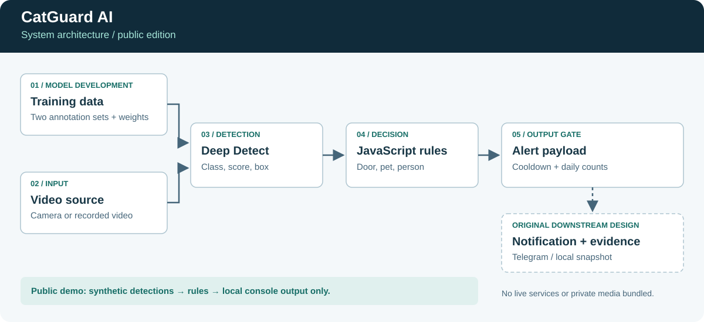

# CatGuard AI

**Smart Cat Monitoring & Door Alert System**

A computer engineering course project (CPE447) combining computer vision with rule-based decision-making to help monitor pets near a doorway.



## Overview

CatGuard AI uses object detection results from CiRA CORE as inputs to a JavaScript decision layer. The controller evaluates door state, pet proximity and human presence, then prepares an alert payload with a cooldown and daily notification statistics. The original system architecture describes local image capture and Telegram notification as downstream components.

This repository package is a **privacy-preserving public edition**, not a complete copy of the original deployment. The included executable example uses synthetic bounding boxes and does not access a camera, write snapshots or send messages.

## Project highlights

| Component | Description |
|---|---|
| Dataset | The project presentation reports 200 source images, with two annotation sets: door/two pet identities/person, and left/right door leaves. |
| Detection | CiRA CORE Deep Detect / cascaded detection as described in the project presentation. |
| Decision layer | JavaScript, confidence filtering, relative door-gap thresholds and rectangular proximity checks. |
| Alert control | Human-presence suppression, 15-second cooldown and daily counters. |
| Output | Alert payload prepared for a downstream notification component. |

## Public resources

- [Public presentation](docs/CatGuard_AI_Public_Presentation.pdf) — newly authored summary, no private screenshots or original media.
- [System architecture](docs/system-diagram.svg) — simplified, redrawn from the project architecture.
- [Logic reference](docs/logic.md) — parameters, assumptions and limitations.
- [Example controller](src/controller.js) — standalone demonstration, not a drop-in CiRA CORE node.

## Run the local demonstration

Requires Node.js (no external packages or network connections).

```sh
node src/demo.js
node --test tests/controller.test.js
```

The demo uses invented bounding boxes and generic labels (`pet_a`, `pet_b`). No credentials or personal information are required. Tests cover the standalone example only, not the original trained model or deployment.

## Limitations

- Bounding boxes in the example use pixel coordinates with top-left origin (`x`, `y`, `w`, `h`). The actual CiRA CORE payload format must be confirmed before integration.
- Door state is a heuristic, not a physical sensor measurement. The original logic assumes closed when only partial door evidence is available; this reference example instead reports unknown.
- Proximity is a rectangular image-space approximation, not a physical distance or a pentagon test.
- Human presence is a suppression rule, not proof of supervision. Missed detections can cause missed or inappropriate alerts.
- Cooldown limits repeat notifications; daily counts are alert counts, not unique escape attempts.
- No independently verified model metrics, live camera performance or notification delivery guarantees are claimed here.

## Privacy and release policy

The original presentation, recorded demonstration, training images, model files, camera settings, Telegram credentials and personal identifiers are deliberately excluded. The public presentation is a new summary rather than a redaction of the original PDF. No original screenshots are included.

Keep local configuration and raw media outside version control. Never commit real credentials, private stream addresses, chat identifiers, home footage or unapproved personal information. Review the complete staged diff before pushing.

See [publication checklist](docs/publish.md) before updating an existing repository. Public sharing does not grant a license to redistribute third-party software, models or group materials; obtain permission before publishing them.
