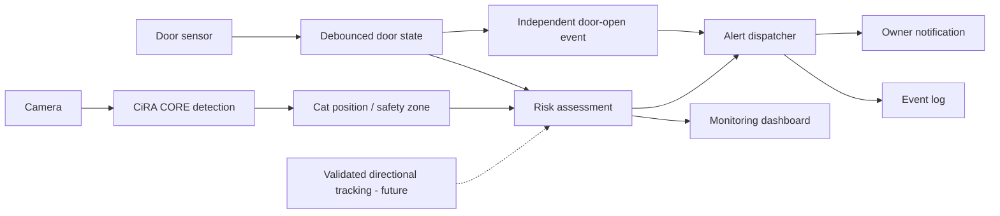

# CatGuard AI

**Smart Cat Monitoring & Door Alert System**

`PROTOTYPE` · `SIMULATED TESTS` · `CiRA CORE CONCEPT` · `ZERO RUNTIME DEPENDENCIES`

CatGuard AI explores how independent door sensing and camera-based cat detection can help an owner notice an open exit and respond when a cat approaches it. This repository provides executable JavaScript reference logic, architecture diagrams, and a reproducible simulation test suite.

> **Evidence boundary:** This is a newly authored reference implementation informed by the supplied project presentation and CiRA CORE screenshot. It is not an exported CiRA project or a validated, deployed monitoring system. No measured detection accuracy, notification latency, or escape-prevention performance is claimed.

## The core behavior

1. **Every observed door opening generates its own alert**, even without a camera result.
2. **A cat near an open exit generates a warning**, in addition to the door alert.
3. **Critical requires validated directional tracking across the doorway.** That capability is not implemented here; this prototype never emits Critical.

No detection does not mean no cat is present. A notification system cannot physically prevent an escape.

## Run the prototype

Install Node.js 22 or later, then run from the repository folder:

```sh
npm test
npm run demo
```

There are no packages to install and no credentials to configure. The demo prints **SIMULATION ONLY** and generates local console output. It does not contact Telegram, open a camera, or read a door sensor.

## Architecture



This is the target architecture. Only the reference risk/event logic and console simulation are implemented in this repository. Sensor, CiRA, dashboard, logging storage and notification adapters remain integration work. The door branch must run even when camera processing is unavailable.

## Decision table

| Door | Camera evidence | Current risk | New alerts |
|---|---|---|---|
| Opens | Missing, stale, no cat, or cat far away | Information | Door Open |
| Opens | Fresh, qualifying cat near exit | Warning | Door Open **and** Cat Near Exit |
| Remains open | Cat enters safety zone | Warning | Cat Near Exit |
| Closed | Any | None | None |
| Unknown | Any | Unknown | None; surface sensor fault in integration |
| Open | Claimed crossing without validated tracking | At most Warning | Never Critical |

Repeated samples of the same condition do not duplicate alerts. Closing and reopening the door creates a fresh alert immediately, with no global cooldown. Startup or reconnection into an open state also emits a baseline door alert.

## Reference API

```js
import { createAlertEngine } from './src/alert-engine.js';

const engine = createAlertEngine();
const result = engine.process({
  timestampMs: 1000,
  door: 'open',
  cat: {
    detected: true,
    nearExit: true,
    confidence: 0.92,
    observedAtMs: 1000
  }
});
console.log(result.alerts); // Independent door event and cat warning
```

Confidence uses a **0–1** scale. The default threshold of `0.8` and maximum detection age of `2000 ms` are reference design choices, not calibrated findings from the source material. `nearExit` must eventually be supplied by a calibrated safety-zone adapter; a detected cat alone is insufficient. See [integration contract](docs/integration.md).

## What is verified?

| Component | Status |
|---|---|
| Independent door-open events | Implemented and tested with synthetic inputs |
| Cat-near-exit warning | Implemented and tested with synthetic inputs |
| Duplicate-state suppression / reopening | Implemented and tested with synthetic inputs |
| Stale or malformed camera input handling | Implemented and tested with synthetic inputs |
| CiRA CORE camera and detection workflow | Visible in supplied screenshot; not executed here |
| Sensor hardware and Telegram delivery | Not validated here |
| Directional tracking / Critical | Future work; intentionally unavailable |
| Accuracy, latency, false-alarm rate | No measured results available |

## Explore the project

- [Architecture and data flow](docs/architecture.md)
- [Input contract and integration boundaries](docs/integration.md)
- [Evaluation plan and simulation coverage](docs/testing.md)
- [Source review and privacy decisions](docs/source-review.md)
- [Upload to GitHub — English / ภาษาไทย](docs/publishing.md)
- [Security and data handling](SECURITY.md)

## Roadmap

- Connect and validate a debounced physical door sensor independently of camera inference.
- Calibrate a doorway safety zone and evaluate detection under low light and occlusion.
- Add a durable notification queue with retries, delivery status and redacted logs.
- Validate directional tracking on labeled doorway sequences before enabling Critical.
- Measure detection quality and end-to-end latency on real hardware.

Original presentation and screenshot are excluded from the publishable package. There are no student identifiers, camera URLs, real event imagery or credentials in the repository. No license is assigned to third-party source assets; confirm ownership before choosing a repository license.
