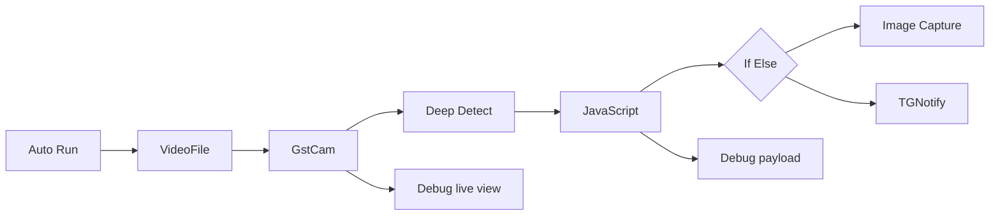
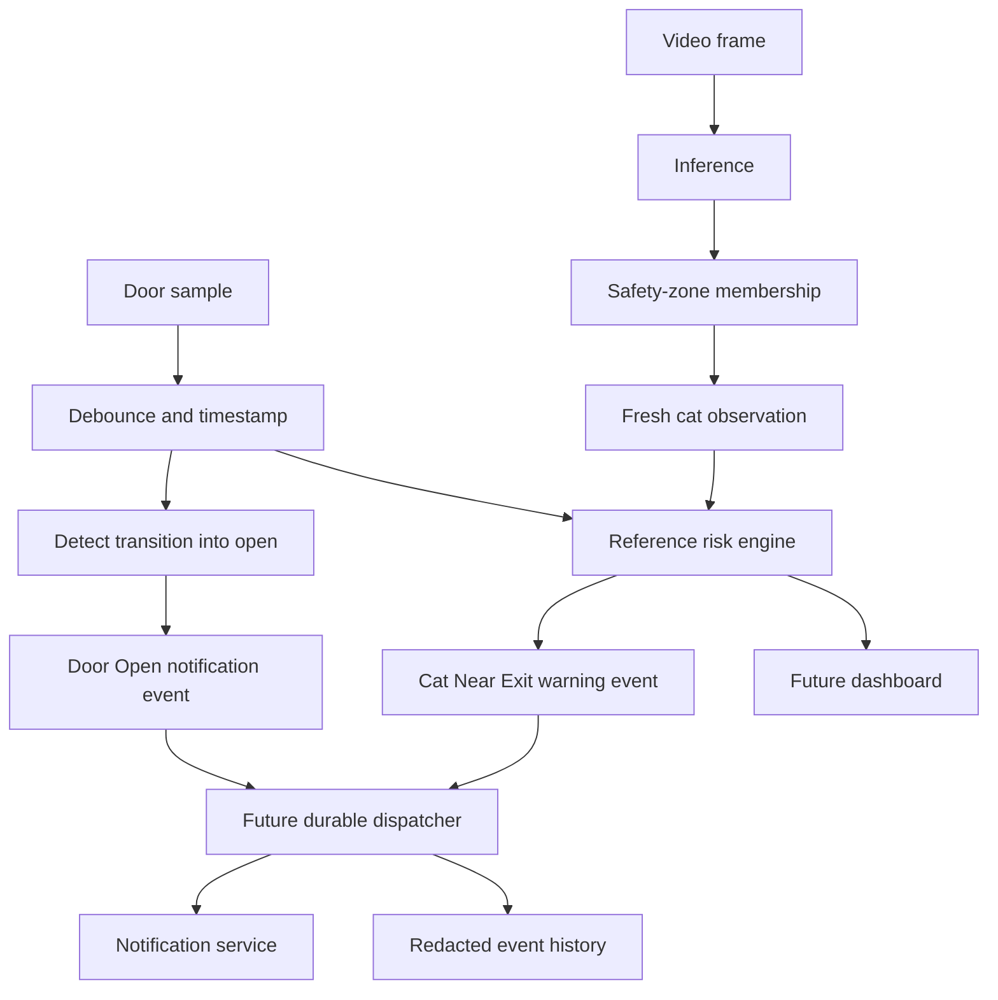

# Architecture and data flow

## Two independent input paths

The presentation's door-event path is authoritative for behavior: a door opening must not wait for cat detection. The photographed CiRA graph describes the existing visual workflow, but does not demonstrate an independent physical door sensor.

### Observed CiRA screenshot

The screenshot shows CiRA CORE 1.9.4, a TEST notification message and `mode: SIMULATE`. Its confidence display is not an accuracy measurement. The diagram is a transcription of visible nodes, not a runnable export.

### Proposed data flow

The reference engine combines transition detection and risk evaluation in a small synchronous API. Integrators must invoke it from door changes even when there is no fresh camera observation; `cat: null` is valid. Never put this call solely behind a successful inference node.

## State semantics

- An engine instance represents one door and one serialized stream.
- `unknown -> open` is a conservative baseline alert, not proof of a newly observed opening.
- Duplicate open samples are suppressed. `open -> closed -> open` always rearms.
- A warning rearms after the qualifying condition clears. No temporal hysteresis is included; flickering detections may cause repeated warnings.
- Closed means no current open-exit warning, not a claim of animal safety.
- Unknown door state remains visibly unknown and must be treated as a device-health concern.
- Critical is reserved for a future validated tracker, not a confidence threshold or a caller-supplied boolean.
